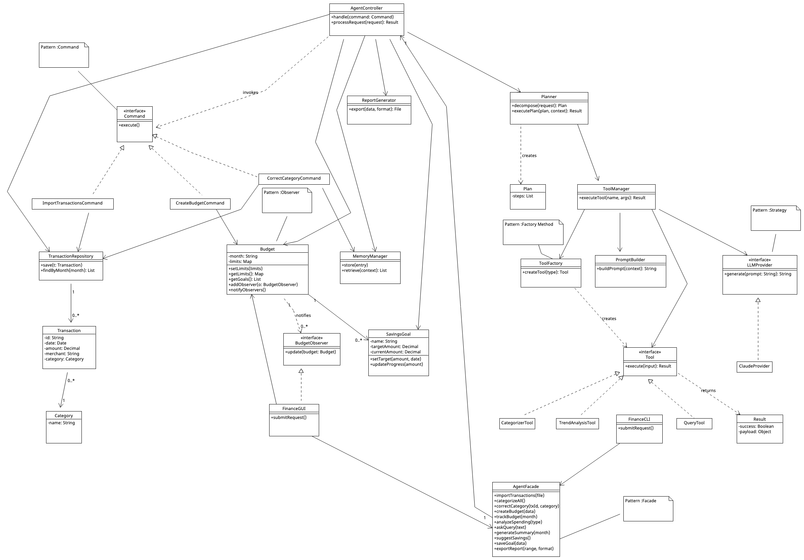
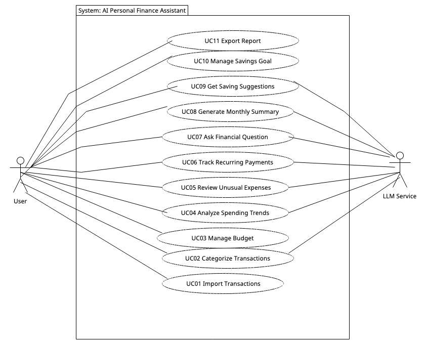
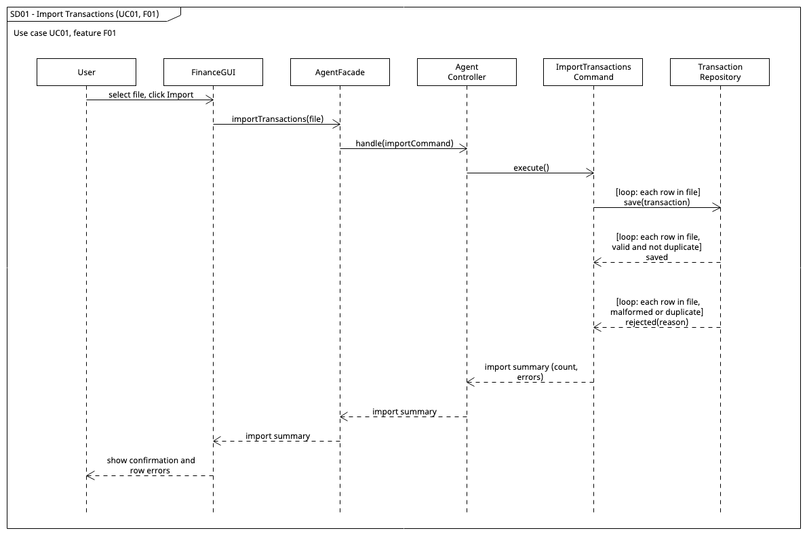
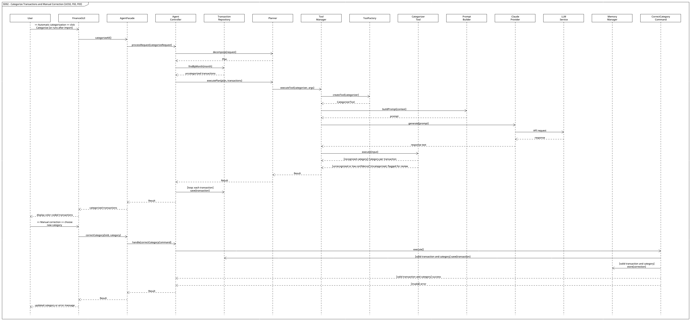
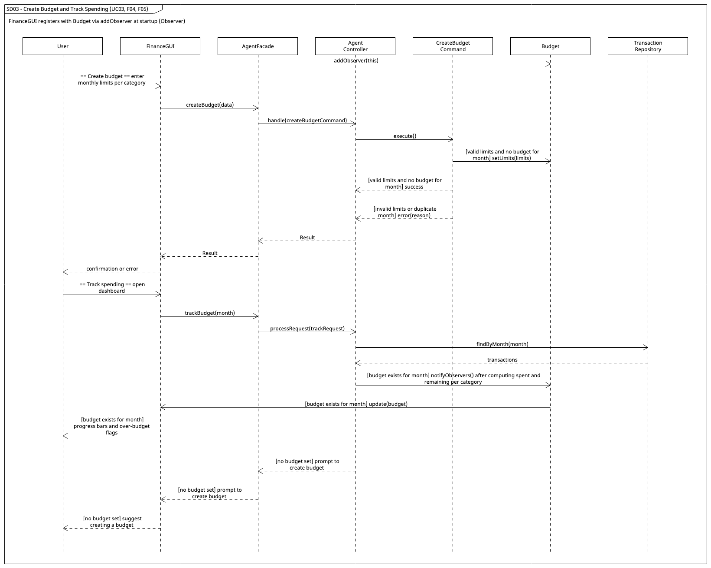
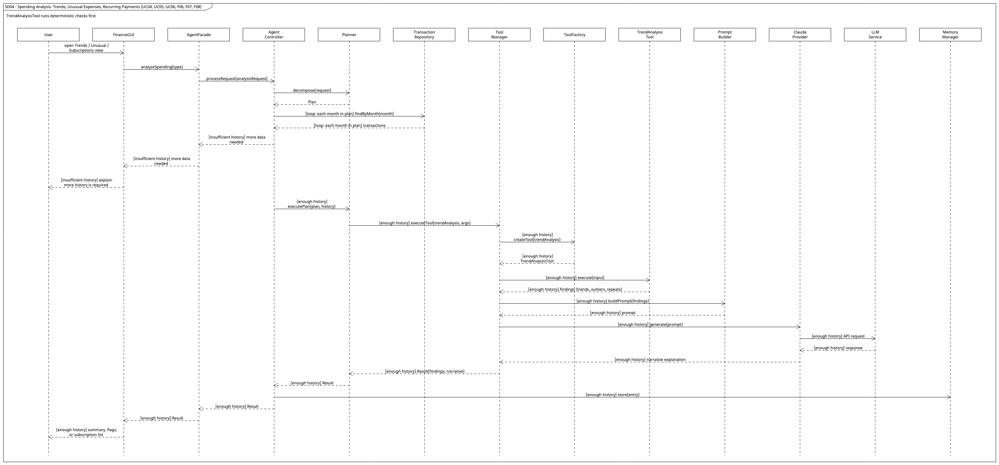
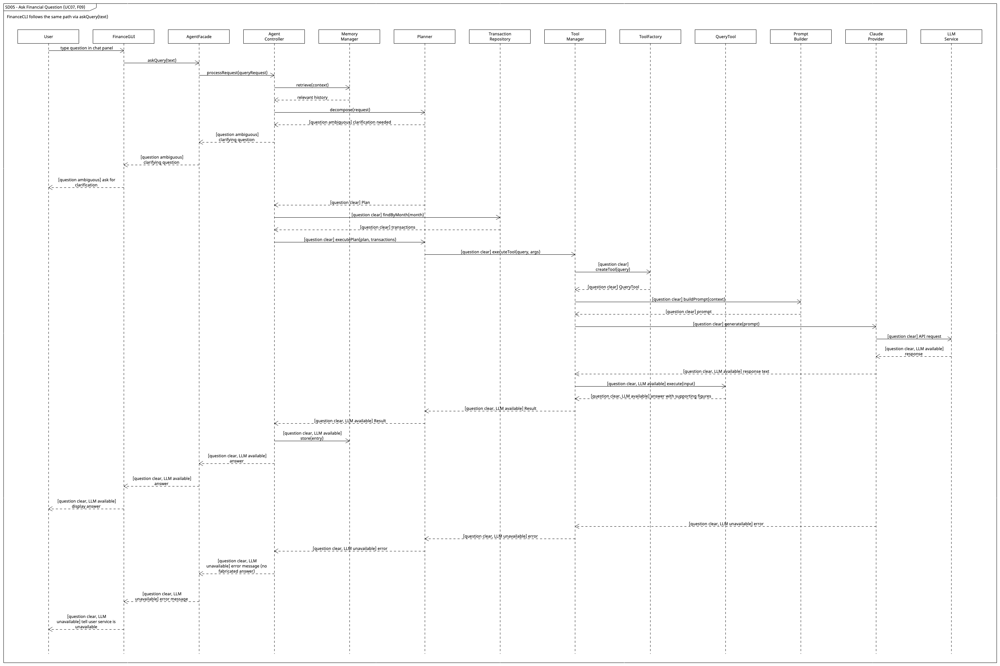
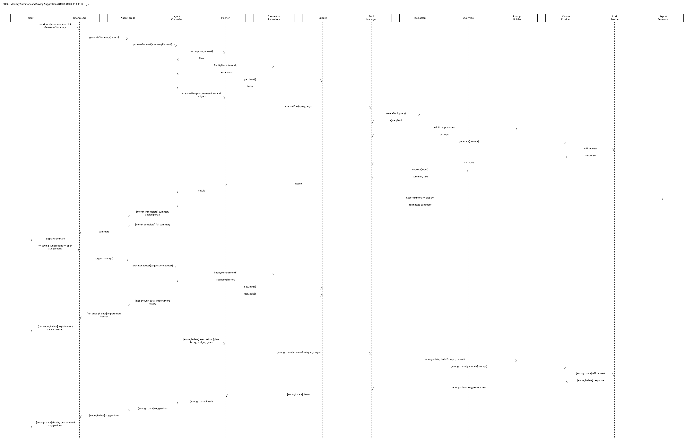
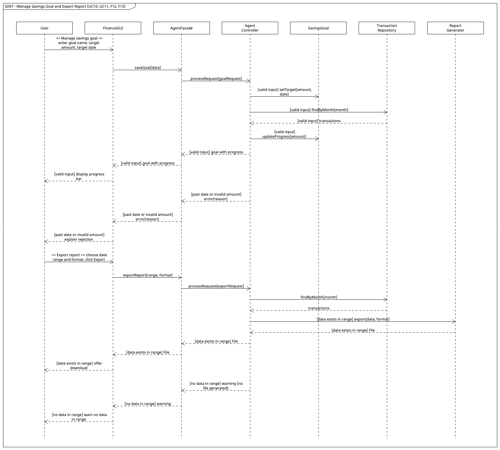

# EECS3311 — Stage 1 Design Report

## AI Personal Finance Assistant

**Student:** Ivan Njuguna (218774968)  
**Course:** EECS3311 Software Design, Fall 2026

---

## 1. Project Overview

- **Problem:** Many people struggle to understand their own spending habits, track budgets, and catch unusual or recurring charges without manually reviewing bank statements.
- **Target users:** Individuals managing personal finances who want automated insight rather than manual spreadsheet tracking.
- **What the agent does:** Imports transactions, categorizes them automatically, tracks budgets and savings goals, detects unusual spending and recurring payments, answers natural-language questions about spending, and generates summaries and saving suggestions.
- **Why an agent fits:** Categorization, trend analysis, and natural-language queries require reasoning over unstructured/varied transaction data, not just fixed rules, and the system benefits from multi-step behavior (retrieve transactions, then analyze, then explain).
- **LLM:** Claude (via API), accessed through an LLMProvider interface so the model can be swapped.
- **Interaction:** GUI (financial dashboard) and CLI both call into a shared AgentFacade.

### Overall Architecture

The system is layered so the GUI and CLI never talk to the AI components directly:

1. **Interface layer:** `FinanceGUI` and `FinanceCLI` collect input and display results.
2. **Entry point:** `AgentFacade` is the single API both interfaces call.
3. **Coordination:** `AgentController` runs state-changing actions as `Command` objects (`handle()`) and AI or read requests through `processRequest()`.
4. **Agent core:** `Planner` decomposes a request into a `Plan` and executes it; `MemoryManager` stores and retrieves context and user corrections.
5. **Tools and LLM:** `ToolManager` obtains tools from `ToolFactory`, builds prompts with `PromptBuilder`, calls the model through the `LLMProvider` interface (`ClaudeProvider`), and passes the response to the tool.
6. **Domain and data:** `Transaction`, `Category`, `Budget`, `SavingsGoal`, `TransactionRepository`, `ReportGenerator`.

### Features at a Glance

| ID | Feature | Type |
|---|---|---|
| F01 | Import transactions (CSV/bank file) | Deterministic |
| F02 | Automatic transaction categorization | AI |
| F03 | Manual category correction | Deterministic |
| F04 | Monthly budget creation | Deterministic |
| F05 | Category-level budget tracking | Deterministic |
| F06 | Spending trend analysis | AI |
| F07 | Unusual-expense detection | AI/Hybrid |
| F08 | Recurring-payment / subscription detection | Hybrid |
| F09 | Natural-language financial queries | AI (retrieval) |
| F10 | Monthly summary generation | AI |
| F11 | Personalized saving suggestions | AI |
| F12 | Savings-goal tracking | Deterministic |
| F13 | Report export | Deterministic |

## 2. Detailed Feature Specifications

### F01 — Import Transactions

- **Description:** Allows the user to upload a bank/credit card transaction file (CSV) into the system.
- **User Interaction:** User clicks "Import" on the dashboard and selects a file.
- **Input:** CSV file containing transaction records (date, amount, merchant, description).
- **Output:** A list of parsed Transaction objects stored in the system.
- **AI Involvement:** Deterministic
- **Expected Workflow:** FinanceGUI sends the file to AgentFacade → AgentController executes ImportTransactionsCommand → the command parses and validates each row and stores it via TransactionRepository → a summary (count, errors) is shown to the user.
- **Error/Alternative Cases:** Malformed CSV, missing required fields, duplicate transactions (already imported) → system flags/skips duplicates and reports parse errors with line numbers.

### F02 — Automatic Transaction Categorization

- **Description:** Assigns a spending category (e.g. Groceries, Rent, Entertainment) to each imported transaction using the LLM.
- **User Interaction:** Runs automatically after import; categorized transactions appear in the dashboard, color-coded by category.
- **Input:** Uncategorized Transaction objects (merchant name, amount, description).
- **Output:** Each transaction updated with a Category.
- **AI Involvement:** AI
- **Expected Workflow:** AgentFacade.categorizeAll() → AgentController asks Planner to decompose the request and execute the plan → ToolManager has ToolFactory create CategorizerTool → ToolManager builds the prompt with PromptBuilder and calls LLMProvider.generate() → CategorizerTool.execute() parses the response into a Category → AgentController saves the updated transaction via TransactionRepository.
- **Error/Alternative Cases:** LLM returns an unrecognized category or low-confidence result → system falls back to "Uncategorized" and flags for manual review (F03).

### F03 — Manual Category Correction

- **Description:** Lets the user override or correct a category assigned to a transaction.
- **User Interaction:** User clicks a transaction's category tag in the dashboard and selects the correct category from a dropdown.
- **Input:** Transaction ID and new Category selection.
- **Output:** Updated Transaction with the corrected Category; correction stored for future reference.
- **AI Involvement:** Deterministic
- **Expected Workflow:** FinanceGUI calls AgentFacade.correctCategory() → AgentController executes CorrectCategoryCommand → the command updates the Transaction's Category via TransactionRepository → MemoryManager stores the correction as a preference for future categorization.
- **Error/Alternative Cases:** Invalid category selected, or transaction not found → system rejects the update and displays an error.

### F04 — Monthly Budget Creation

- **Description:** Allows the user to define a spending budget for a given month, optionally broken down by category.
- **User Interaction:** User opens the Budget panel and enters monthly limits per category.
- **Input:** Month, category list, and limit amounts.
- **Output:** A Budget object stored for that month.
- **AI Involvement:** Deterministic
- **Expected Workflow:** FinanceGUI calls AgentFacade.createBudget() → AgentController executes CreateBudgetCommand → the command validates the limits and sets them on the Budget.
- **Error/Alternative Cases:** Negative or zero limits, duplicate budget for the same month → system rejects invalid values and warns about duplicates.

### F05 — Category-Level Budget Tracking

- **Description:** Tracks actual spending per category against the budgeted limit and shows remaining balance.
- **User Interaction:** Dashboard automatically displays progress bars per category as transactions are categorized.
- **Input:** Current month's Transactions and the active Budget.
- **Output:** Per-category spent/remaining amounts and over-budget flags.
- **AI Involvement:** Deterministic
- **Expected Workflow:** AgentController requests current Transactions from TransactionRepository → compares totals against Budget limits → Budget.notifyObservers() causes FinanceGUI (a BudgetObserver) to refresh its per-category progress display.
- **Error/Alternative Cases:** No budget set for the current month → system prompts the user to create one (F04).

### F06 — Spending Trend Analysis

- **Description:** Analyzes spending over time and identifies trends (e.g. increasing dining spend over 3 months).
- **User Interaction:** User clicks "Analyze Trends" or views the Trends tab.
- **Input:** Historical Transactions across multiple months.
- **Output:** A natural-language trend summary plus supporting chart data.
- **AI Involvement:** AI
- **Expected Workflow:** AgentController loads history from TransactionRepository → Planner executes the plan via ToolManager, which has ToolFactory create TrendAnalysisTool → TrendAnalysisTool.execute() aggregates the history → ToolManager builds a prompt and calls LLMProvider.generate() for a narrative explanation → result returned to the GUI.
- **Error/Alternative Cases:** Insufficient historical data (e.g. only 1 month) → system informs the user more data is needed for a meaningful trend.

### F07 — Unusual-Expense Detection

- **Description:** Flags transactions that are significantly larger or unusual compared to the user's typical spending pattern.
- **User Interaction:** Flagged transactions appear with a warning icon on the dashboard; user can dismiss or investigate.
- **Input:** New Transaction plus historical spending pattern per category.
- **Output:** A list of flagged Transactions with a brief explanation of why each is unusual.
- **AI Involvement:** AI/Hybrid
- **Expected Workflow:** TrendAnalysisTool (analysis type 'unusual') runs a deterministic statistical check first (e.g. amount exceeds category average by a threshold) → borderline cases are passed through ToolManager to LLMProvider for a contextual judgment and explanation.
- **Error/Alternative Cases:** Legitimate large purchase incorrectly flagged → user can dismiss the flag, which is recorded to reduce future false positives.

### F08 — Recurring-Payment/Subscription Detection

- **Description:** Identifies transactions that repeat on a regular interval (e.g. monthly subscriptions) and lists them separately.
- **User Interaction:** User views the "Subscriptions" panel showing detected recurring charges.
- **Input:** Historical Transactions grouped by merchant.
- **Output:** A list of identified recurring payments with frequency and amount.
- **AI Involvement:** Hybrid
- **Expected Workflow:** TrendAnalysisTool (analysis type 'recurring') runs a deterministic pattern check (same merchant/amount at regular intervals) → ambiguous cases are sent through ToolManager to LLMProvider to confirm or describe the subscription.
- **Error/Alternative Cases:** Merchant name varies slightly between charges (e.g. "Netflix" vs "NETFLIX.COM") → LLM-assisted matching used to merge likely duplicates, with user confirmation.

### F09 — Natural-Language Financial Queries

- **Description:** Lets the user ask free-form questions about their finances (e.g. "How much did I spend on food in June?").
- **User Interaction:** User types a question into the AI chat panel.
- **Input:** User's natural-language question; relevant Transactions retrieved as context.
- **Output:** A natural-language answer, optionally with supporting figures/chart.
- **AI Involvement:** AI (retrieval)
- **Expected Workflow:** FinanceGUI/FinanceCLI sends the query to AgentFacade.askQuery() → AgentController retrieves context from MemoryManager and asks Planner what data is needed → relevant Transactions are fetched via TransactionRepository → ToolManager (tool created by ToolFactory) builds the prompt with PromptBuilder and calls LLMProvider.generate() → QueryTool.execute() produces the answer.
- **Error/Alternative Cases:** Query is ambiguous or references data not available → agent asks a clarifying question or states what data is missing rather than fabricating an answer.

### F10 — Monthly Summary Generation

- **Description:** Produces an automatic end-of-month summary of income, spending, and budget performance.
- **User Interaction:** User clicks "Generate Summary" or receives it automatically at month end.
- **Input:** Full month's Transactions and Budget.
- **Output:** A natural-language summary report.
- **AI Involvement:** AI
- **Expected Workflow:** AgentController gathers the month's Transactions and Budget → Planner runs QueryTool through ToolManager, which builds the prompt with PromptBuilder and calls LLMProvider.generate() → ReportGenerator formats the result.
- **Error/Alternative Cases:** Incomplete month data (e.g. mid-month request) → system clearly labels the summary as partial.

### F11 — Personalized Saving Suggestions

- **Description:** Suggests specific ways the user could reduce spending or save more, based on their patterns.
- **User Interaction:** Suggestions appear in the AI chat panel or a dedicated "Suggestions" section.
- **Input:** Spending history, active Budgets, and savings goals.
- **Output:** A list of concrete, personalized suggestions.
- **AI Involvement:** AI
- **Expected Workflow:** AgentController invokes Planner → relevant data gathered from TransactionRepository, Budget and SavingsGoal → Planner runs QueryTool through ToolManager, which builds the prompt with PromptBuilder and calls LLMProvider.generate() to produce suggestions.
- **Error/Alternative Cases:** Not enough data to generate meaningful suggestions → system informs the user and suggests importing more transaction history.

### F12 — Savings-Goal Tracking

- **Description:** Lets the user set a savings goal (e.g. $2000 for a trip) and tracks progress toward it.
- **User Interaction:** User creates a goal in the Goals panel and views a progress bar.
- **Input:** Goal name, target amount, target date, and current savings contributions.
- **Output:** A SavingsGoal object with updated progress.
- **AI Involvement:** Deterministic
- **Expected Workflow:** GUI sends goal data to AgentController → SavingsGoal created/updated and stored → progress recalculated whenever relevant transactions are recorded.
- **Error/Alternative Cases:** Target date in the past, or negative target amount → system rejects invalid input.

### F13 — Report Export

- **Description:** Allows the user to export a summary or transaction report as a file (e.g. PDF/CSV).
- **User Interaction:** User clicks "Export" and selects a format and date range.
- **Input:** Date range, report type, and export format.
- **Output:** A downloadable report file.
- **AI Involvement:** Deterministic
- **Expected Workflow:** GUI sends export request to AgentController → ReportGenerator compiles the requested data → file generated and returned to the user.
- **Error/Alternative Cases:** No data in the selected date range → system warns the user and does not generate an empty file.

## 3. UML Class Diagram

The diagram shows both the traditional components (GUI, CLI, repository, domain classes) and the agent components (`Planner`, `MemoryManager`, `ToolManager`, `ToolFactory`, `Tool` implementations, `PromptBuilder`, `LLMProvider`). Multiplicities are shown where meaningful, and each pattern is labelled with a note.

## 4. Design Patterns

### 1. Strategy

- **Participating classes:** LLMProvider (interface), ClaudeProvider
- **Problem addressed:** the system needs to call an LLM without hard-coding which model/provider is used.
- **Role:** LLMProvider defines generate(prompt). ClaudeProvider implements it. ToolManager depends only on the interface.
- **Why appropriate:** allows switching or adding LLM providers without touching the calling code.
- **Without it:** swapping or adding a model would require editing ToolManager's logic directly, increasing coupling.

### 2. Facade

- **Participating classes:** AgentFacade
- **Problem addressed:** both the GUI and CLI need a simple, unified way to trigger agent functionality without knowing internal collaboration details.
- **Role:** AgentFacade exposes high-level methods (importTransactions(), askQuery(), etc.) and delegates to AgentController, which coordinates Planner and ToolManager.
- **Why appropriate:** keeps FinanceGUI and FinanceCLI thin and decoupled from internal agent architecture.
- **Without it:** GUI and CLI would each need to know the full internal call sequence, duplicating logic and increasing coupling.

### 3. Factory Method

- **Participating classes:** ToolFactory, Tool (interface), CategorizerTool, TrendAnalysisTool, QueryTool
- **Problem addressed:** ToolManager needs to create different tool objects without knowing their concrete classes.
- **Role:** ToolFactory.createTool(type) returns the correct Tool implementation.
- **Why appropriate:** new tools can be added by extending the factory, without modifying ToolManager.
- **Without it:** ToolManager would need conditional logic (if/else or switch) to construct each tool type directly.

### 4. Observer

- **Participating classes:** Budget, BudgetObserver (interface), FinanceGUI
- **Problem addressed:** the dashboard must reflect budget changes as new transactions are categorized, without constantly polling.
- **Role:** Budget maintains a list of BudgetObserver subscribers and calls notifyObservers() when spending changes. FinanceGUI implements BudgetObserver.
- **Why appropriate:** decouples Budget from the specific UI that displays it; any future view (e.g. a mobile client) could subscribe too.
- **Without it:** the GUI would need to poll for budget changes on a timer instead of updating reactively.

### 5. Command

- **Participating classes:** Command (interface), ImportTransactionsCommand, CorrectCategoryCommand, CreateBudgetCommand
- **Problem addressed:** user actions need to be logged, and potentially retried or undone, rather than executed as direct method calls.
- **Role:** each user action is wrapped in a Command object with an execute() method; AgentController invokes commands rather than calling logic directly.
- **Why appropriate:** provides a clean extension point for history, undo, and testing/replay of user actions.
- **Without it:** there is no structured way to log, undo, or replay user actions; each action would be an untracked direct call.

### Other Design Decisions

- **Two controller entry points.** State-changing user actions (import, correct category, create budget) are `Command` objects run through `handle(command)`; AI and read requests go through `processRequest(request)`. This keeps the Command pattern meaningful and keeps history/undo possible where it matters.
- **One facade for both interfaces.** `FinanceGUI` and `FinanceCLI` call identical `AgentFacade` methods, so every feature is available from both and no logic is duplicated.
- **Tools stay free of network code.** `ToolManager` builds the prompt and calls `LLMProvider.generate()`, then hands the response to `Tool.execute()`. Tools depend on the `Tool` interface only (dependency inversion), so they can be tested without a live model.
- **Shared tools.** `TrendAnalysisTool` serves trends, unusual-expense and recurring-payment analysis (selected by a type argument); `QueryTool` serves context-grounded generation (questions, monthly summaries, saving suggestions) with different prompts.
- **Deterministic first, LLM second.** For hybrid features (F07, F08) a deterministic check runs first and the LLM is used only for borderline cases and explanations, which limits cost and the risk of unsupported answers.
- **No fabricated answers.** If the LLM is unavailable or data is insufficient, the system tells the user instead of producing an answer (F06, F09, F11).

## 5. Use-Case Diagram

**Actors:** **User** (primary) uses all features through the GUI or CLI. **LLM Service** (external) supports the AI-based use cases (UC02, UC04–UC09).

## 6. Use-Case Descriptions

### UC01 — Import Transactions

- **Actor(s):** User
- **Goal:** Load transaction data into the system for analysis.
- **Preconditions:** The system is running; the user has a transaction file (CSV).
- **Trigger:** User selects "Import" and chooses a file.
- **Main Success Scenario:**

    1. User selects a file.
    2. System parses the file.
    3. System validates and stores transactions.
    4. System confirms the number imported.

- **Alternative/Exception Flows:** If the file is malformed, the system reports which rows failed and imports the valid rows. If duplicate transactions are detected, they are skipped and flagged.
- **Postconditions:** New transactions are stored and available for categorization.
- **Related Feature(s):** F01

### UC02 — Categorize Transactions

- **Actor(s):** User, LLM Service
- **Goal:** Assign a spending category to each transaction, with the option for the user to correct it.
- **Preconditions:** Transactions have been imported (UC01).
- **Trigger:** New transactions are imported, or the user requests re-categorization.
- **Main Success Scenario:**

    1. System sends uncategorized transactions to the LLM via the CategorizerTool.
    2. LLM returns a category for each transaction.
    3. System updates and displays the categorized transactions.
    4. User may manually correct a category.

- **Alternative/Exception Flows:** If the LLM returns an unrecognized or low-confidence category, the transaction is marked "Uncategorized" for manual review. If the user corrects a category, the correction is stored for future reference.
- **Postconditions:** All transactions have a category (automatic or user-corrected).
- **Related Feature(s):** F02, F03

### UC03 — Manage Budget

- **Actor(s):** User
- **Goal:** Create a monthly budget and track spending against it by category.
- **Preconditions:** The system is running.
- **Trigger:** User opens the Budget panel.
- **Main Success Scenario:**

    1. User enters monthly limits per category.
    2. System saves the budget.
    3. System compares current spending to limits.
    4. System displays per-category progress.

- **Alternative/Exception Flows:** If limits are invalid (negative/zero) or a budget already exists for that month, the system rejects or warns the user. If no budget exists when the dashboard loads, the system prompts the user to create one.
- **Postconditions:** A budget is stored and spending progress is visible.
- **Related Feature(s):** F04, F05

### UC04 — Analyze Spending Trends

- **Actor(s):** User, LLM Service
- **Goal:** Understand how spending has changed over time.
- **Preconditions:** The user has at least two months of transaction history.
- **Trigger:** User opens the Trends tab or clicks "Analyze Trends."
- **Main Success Scenario:**

    1. System aggregates historical transactions.
    2. System sends the aggregated data to the LLM.
    3. LLM generates a narrative trend summary.
    4. System displays the summary with supporting chart data.

- **Alternative/Exception Flows:** If insufficient historical data exists, the system informs the user more data is needed rather than generating a misleading trend.
- **Postconditions:** The user has a narrative explanation of their spending trends.
- **Related Feature(s):** F06

### UC05 — Review Unusual Expenses

- **Actor(s):** User, LLM Service
- **Goal:** Identify and review transactions that deviate from the user's normal spending pattern.
- **Preconditions:** The user has an established spending history.
- **Trigger:** A new transaction is imported, or the user opens the flagged-expenses view.
- **Main Success Scenario:**

    1. System runs a statistical check against the category average.
    2. Borderline cases are sent to the LLM for contextual judgment.
    3. Flagged transactions are displayed with an explanation.
    4. User reviews and may dismiss a flag.

- **Alternative/Exception Flows:** If the user dismisses a flag, the dismissal is recorded to reduce future false positives for similar transactions.
- **Postconditions:** The user has reviewed all flagged transactions for the period.
- **Related Feature(s):** F07

### UC06 — Track Recurring Payments

- **Actor(s):** User, LLM Service
- **Goal:** Identify subscriptions and other recurring charges.
- **Preconditions:** The user has at least one recurring charge in their transaction history.
- **Trigger:** User opens the Subscriptions panel.
- **Main Success Scenario:**

    1. System checks for same merchant/amount at regular intervals.
    2. Ambiguous cases (e.g. slightly different merchant names) are sent to the LLM to confirm a match.
    3. System displays the list of recurring payments with frequency and amount.

- **Alternative/Exception Flows:** If the LLM-assisted match is incorrect, the user can reject the merge, and the items remain separate.
- **Postconditions:** The user has a confirmed list of recurring payments.
- **Related Feature(s):** F08

### UC07 — Ask Financial Question

- **Actor(s):** User, LLM Service
- **Goal:** Get a natural-language answer to a question about personal spending.
- **Preconditions:** The user has imported transaction data; the LLM service is reachable.
- **Trigger:** User types a question into the chat panel.
- **Main Success Scenario:**

    1. User submits a question.
    2. Agent determines what data is needed.
    3. Agent retrieves relevant transactions.
    4. Agent sends context and question to the LLM.
    5. LLM generates an answer.
    6. Answer is displayed to the user.

- **Alternative/Exception Flows:** If the question is ambiguous, the agent asks a clarifying question instead of guessing. If the LLM service is unavailable, the system informs the user and does not fabricate an answer.
- **Postconditions:** The user receives an answer or a clarifying follow-up.
- **Related Feature(s):** F09

### UC08 — Generate Monthly Summary

- **Actor(s):** User, LLM Service
- **Goal:** Produce an end-of-month overview of income, spending, and budget performance.
- **Preconditions:** At least one transaction exists for the target month.
- **Trigger:** User clicks "Generate Summary," or the system triggers it automatically at month end.
- **Main Success Scenario:**

    1. System gathers the month's transactions and budget.
    2. Data is sent to the LLM.
    3. LLM generates a narrative summary.
    4. System formats and displays the report.

- **Alternative/Exception Flows:** If the request is made mid-month, the summary is clearly labeled as partial/incomplete.
- **Postconditions:** The user has a readable summary of the month's finances.
- **Related Feature(s):** F10

### UC09 — Get Saving Suggestions

- **Actor(s):** User, LLM Service
- **Goal:** Receive personalized suggestions for reducing spending or increasing savings.
- **Preconditions:** The user has sufficient spending history and at least one active budget or savings goal.
- **Trigger:** User opens the Suggestions section or asks for saving tips.
- **Main Success Scenario:**

    1. System gathers spending history, budgets, and goals.
    2. Data is sent to the LLM.
    3. LLM generates specific, personalized suggestions.
    4. Suggestions are displayed to the user.

- **Alternative/Exception Flows:** If there is not enough data, the system explains this and suggests importing more transaction history first.
- **Postconditions:** The user has a list of actionable suggestions.
- **Related Feature(s):** F11

### UC10 — Manage Savings Goal

- **Actor(s):** User
- **Goal:** Set and track progress toward a savings goal.
- **Preconditions:** The system is running.
- **Trigger:** User opens the Goals panel and creates or updates a goal.
- **Main Success Scenario:**

    1. User enters goal name, target amount, and target date.
    2. System stores the goal.
    3. System recalculates progress as relevant transactions are recorded.
    4. Progress is displayed to the user.

- **Alternative/Exception Flows:** If the target date is in the past or the amount is invalid, the system rejects the input with an explanation.
- **Postconditions:** The goal is stored and progress is tracked over time.
- **Related Feature(s):** F12

### UC11 — Export Report

- **Actor(s):** User
- **Goal:** Export a financial report or transaction list as a file.
- **Preconditions:** Transaction data exists for the selected date range.
- **Trigger:** User clicks "Export" and selects a format and date range.
- **Main Success Scenario:**

    1. User specifies the date range, report type, and format.
    2. System compiles the requested data.
    3. System generates the file.
    4. File is made available for download.

- **Alternative/Exception Flows:** If no data exists in the selected range, the system warns the user and does not generate an empty file.
- **Postconditions:** The user has a downloadable report file.
- **Related Feature(s):** F13

## 7. Sequence Diagrams

Closely related features share an interaction structure and therefore share a diagram. Conditions on alternative flows are written as bracketed guards on the messages (for example `[valid input]`). Dashed arrows are returns.

### SD01 — Import Transactions

**Use cases:** UC01 &nbsp;|&nbsp; **Features:** F01

### SD02 — Categorize Transactions and Manual Correction

**Use cases:** UC02 &nbsp;|&nbsp; **Features:** F02, F03

### SD03 — Create Budget and Track Spending (Observer)

**Use cases:** UC03 &nbsp;|&nbsp; **Features:** F04, F05

### SD04 — Spending Analysis: Trends, Unusual Expenses, Recurring Payments

**Use cases:** UC04, UC05, UC06 &nbsp;|&nbsp; **Features:** F06, F07, F08

### SD05 — Ask Financial Question

**Use cases:** UC07 &nbsp;|&nbsp; **Features:** F09

### SD06 — Monthly Summary and Saving Suggestions

**Use cases:** UC08, UC09 &nbsp;|&nbsp; **Features:** F10, F11

### SD07 — Manage Savings Goal and Export Report

**Use cases:** UC10, UC11 &nbsp;|&nbsp; **Features:** F12, F13

## 8. Feature-to-Design Traceability

| ID | Feature | Type | Use Case | Classes | Key Methods | Sequence Diagram | Design Pattern(s) |
|---|---|---|---|---|---|---|---|
| F01 | Import transactions | Deterministic | UC01 | FinanceGUI, FinanceCLI, AgentFacade, AgentController, ImportTransactionsCommand, TransactionRepository, Transaction | submitRequest(), importTransactions(file), handle(command), execute(), save(t) | SD01 | Facade, Command |
| F02 | Auto categorization | AI | UC02 | FinanceGUI, AgentFacade, AgentController, Planner, ToolManager, ToolFactory, CategorizerTool, PromptBuilder, ClaudeProvider, TransactionRepository, Category | categorizeAll(), processRequest(), decompose(), executePlan(), executeTool(), createTool(), buildPrompt(), generate(), execute(), save(t) | SD02 | Facade, Factory Method, Strategy |
| F03 | Manual category correction | Deterministic | UC02 | FinanceGUI, AgentFacade, AgentController, CorrectCategoryCommand, TransactionRepository, MemoryManager | correctCategory(txId, category), handle(command), execute(), save(t), store(entry) | SD02 | Facade, Command |
| F04 | Monthly budget creation | Deterministic | UC03 | FinanceGUI, AgentFacade, AgentController, CreateBudgetCommand, Budget | createBudget(data), handle(command), execute(), setLimits(limits) | SD03 | Facade, Command |
| F05 | Category budget tracking | Deterministic | UC03 | FinanceGUI (as BudgetObserver), AgentFacade, AgentController, TransactionRepository, Budget | trackBudget(month), processRequest(), findByMonth(month), notifyObservers(), update(budget) | SD03 | Observer, Facade |
| F06 | Spending trend analysis | AI | UC04 | FinanceGUI, AgentFacade, AgentController, Planner, TransactionRepository, ToolManager, ToolFactory, TrendAnalysisTool, PromptBuilder, ClaudeProvider, MemoryManager | analyzeSpending(type), processRequest(), decompose(), findByMonth(), executePlan(), executeTool(), createTool(), execute(), buildPrompt(), generate(), store() | SD04 | Facade, Factory Method, Strategy |
| F07 | Unusual-expense detection | AI/Hybrid | UC05 | Same as F06 (type = unusual) | Same as F06 | SD04 | Facade, Factory Method, Strategy |
| F08 | Recurring-payment detection | Hybrid | UC06 | Same as F06 (type = recurring) | Same as F06 | SD04 | Facade, Factory Method, Strategy |
| F09 | Natural-language queries | AI (retrieval) | UC07 | FinanceGUI, FinanceCLI, AgentFacade, AgentController, MemoryManager, Planner, TransactionRepository, ToolManager, ToolFactory, QueryTool, PromptBuilder, ClaudeProvider | askQuery(text), processRequest(), retrieve(context), decompose(), findByMonth(), executePlan(), executeTool(), createTool(), buildPrompt(), generate(), execute(), store() | SD05 | Facade, Factory Method, Strategy |
| F10 | Monthly summary | AI | UC08 | FinanceGUI, AgentFacade, AgentController, Planner, TransactionRepository, Budget, ToolManager, ToolFactory, QueryTool, PromptBuilder, ClaudeProvider, ReportGenerator | generateSummary(month), processRequest(), getLimits(), executePlan(), executeTool(), buildPrompt(), generate(), execute(), export(data, format) | SD06 | Facade, Factory Method, Strategy |
| F11 | Saving suggestions | AI | UC09 | FinanceGUI, AgentFacade, AgentController, Planner, TransactionRepository, Budget, SavingsGoal, ToolManager, QueryTool, PromptBuilder, ClaudeProvider | suggestSavings(), processRequest(), findByMonth(), getLimits(), getGoals(), executePlan(), executeTool(), buildPrompt(), generate() | SD06 | Facade, Factory Method, Strategy |
| F12 | Savings-goal tracking | Deterministic | UC10 | FinanceGUI, AgentFacade, AgentController, SavingsGoal, TransactionRepository | saveGoal(data), processRequest(), setTarget(amount, date), updateProgress(amount), findByMonth(month) | SD07 | Facade |
| F13 | Report export | Deterministic | UC11 | FinanceGUI, AgentFacade, AgentController, TransactionRepository, ReportGenerator | exportReport(range, format), processRequest(), findByMonth(month), export(data, format) | SD07 | Facade |

Every feature is available from both `FinanceGUI` and `FinanceCLI`, which call the same `AgentFacade` methods.

## 9. How Each Feature Is Realized

### F01 — Import Transactions

- **Related Use Case:** UC01
- **Related Sequence Diagram:** SD01
- **Classes involved:** FinanceGUI/FinanceCLI collect the file; AgentFacade is the single entry point; AgentController runs the command; ImportTransactionsCommand parses rows; TransactionRepository stores them; Transaction is the stored record.
- **Important methods:** FinanceGUI.submitRequest(), AgentFacade.importTransactions(file), AgentController.handle(command), ImportTransactionsCommand.execute(), TransactionRepository.save(t)
- **Execution:** The user selects a file. The facade passes an import command to the controller, which executes it. Each row is validated and saved; malformed rows and duplicates are rejected with a reason. An import summary (count, errors) returns to the GUI.

### F02 — Automatic Categorization

- **Related Use Case:** UC02
- **Related Sequence Diagram:** SD02
- **Classes involved:** AgentController coordinates; Planner decomposes the request and executes the plan; ToolManager runs tools; ToolFactory creates CategorizerTool; PromptBuilder builds the prompt; ClaudeProvider calls the LLM; CategorizerTool interprets the result; TransactionRepository stores updated transactions.
- **Important methods:** AgentFacade.categorizeAll(), AgentController.processRequest(), Planner.decompose()/executePlan(), ToolManager.executeTool(), ToolFactory.createTool(), PromptBuilder.buildPrompt(), LLMProvider.generate(), Tool.execute(), TransactionRepository.save(t)
- **Execution:** The controller fetches uncategorized transactions and the Planner executes a plan via ToolManager. ToolManager builds the prompt with PromptBuilder, calls LLMProvider.generate() (implemented by ClaudeProvider), and passes the response to the tool's execute(). Recognized categories are assigned; unrecognized or low-confidence results become 'Uncategorized' and are flagged for manual review (F03).

### F03 — Manual Category Correction

- **Related Use Case:** UC02
- **Related Sequence Diagram:** SD02
- **Classes involved:** CorrectCategoryCommand encapsulates the correction; TransactionRepository saves it; MemoryManager remembers it as a preference.
- **Important methods:** AgentFacade.correctCategory(txId, category), AgentController.handle(command), CorrectCategoryCommand.execute(), TransactionRepository.save(t), MemoryManager.store(entry)
- **Execution:** The user picks a new category. The facade wraps the action in a command; the controller executes it. If the transaction and category are valid, the change is saved and the correction stored in memory; otherwise an error is returned.

### F04 — Monthly Budget Creation

- **Related Use Case:** UC03
- **Related Sequence Diagram:** SD03
- **Classes involved:** CreateBudgetCommand validates and applies the limits; Budget holds the month's limits.
- **Important methods:** AgentFacade.createBudget(data), AgentController.handle(command), CreateBudgetCommand.execute()
- **Execution:** The user enters limits per category. The command rejects negative/zero limits and duplicate months; otherwise it sets the limits on the Budget and returns success.

### F05 — Category-Level Budget Tracking

- **Related Use Case:** UC03
- **Related Sequence Diagram:** SD03
- **Classes involved:** TransactionRepository supplies the month's transactions; AgentController compares totals with limits; Budget notifies registered observers; FinanceGUI (a BudgetObserver) refreshes its progress bars.
- **Important methods:** AgentFacade.trackBudget(month), AgentController.processRequest(), TransactionRepository.findByMonth(), Budget.notifyObservers(), BudgetObserver.update(budget)
- **Execution:** FinanceGUI registers with Budget at startup. When tracking runs, the controller computes spent/remaining per category and calls notifyObservers(), which triggers update(budget) in the GUI. If no budget exists, the user is prompted to create one.

### F06 — Spending Trend Analysis

- **Related Use Case:** UC04
- **Related Sequence Diagram:** SD04
- **Classes involved:** Same collaboration structure as F02, with TrendAnalysisTool in place of CategorizerTool; MemoryManager stores the result.
- **Important methods:** AgentFacade.analyzeSpending(type), AgentController.processRequest(), Planner.decompose()/executePlan(), TransactionRepository.findByMonth(), ToolManager.executeTool(), TrendAnalysisTool.execute()
- **Execution:** The controller loads history for the months in the plan. If there is too little data, the user is told so. Otherwise TrendAnalysisTool computes deterministic statistics first, then toolManager builds the prompt with PromptBuilder, calls LLMProvider.generate() (implemented by ClaudeProvider), and passes the response to the tool's execute(). The narrative and chart data return to the GUI.

### F07 — Unusual-Expense Detection

- **Related Use Case:** UC05
- **Related Sequence Diagram:** SD04
- **Classes involved:** As F06, with analysis type 'unusual'.
- **Important methods:** AgentFacade.analyzeSpending('unusual'), then as F06
- **Execution:** TrendAnalysisTool's deterministic check flags amounts far above the category average; the LLM explains borderline cases. Flags are shown with an explanation; dismissals are stored to reduce false positives.

### F08 — Recurring-Payment Detection

- **Related Use Case:** UC06
- **Related Sequence Diagram:** SD04
- **Classes involved:** As F06, with analysis type 'recurring'.
- **Important methods:** AgentFacade.analyzeSpending('recurring'), then as F06
- **Execution:** A deterministic check finds the same merchant/amount at regular intervals; the LLM helps match merchant-name variants. The user sees the subscription list and can reject an incorrect merge.

### F09 — Natural-Language Financial Queries

- **Related Use Case:** UC07
- **Related Sequence Diagram:** SD05
- **Classes involved:** MemoryManager provides conversation context; Planner decides what data is needed and whether to ask for clarification; QueryTool produces the grounded answer.
- **Important methods:** AgentFacade.askQuery(text), AgentController.processRequest(), MemoryManager.retrieve(), Planner.decompose()/executePlan(), TransactionRepository.findByMonth(), ToolManager.executeTool(), QueryTool.execute()
- **Execution:** If the question is ambiguous, a clarifying question is returned. Otherwise the relevant transactions are fetched and the plan runs through ToolManager. ToolManager builds the prompt with PromptBuilder, calls LLMProvider.generate() (implemented by ClaudeProvider), and passes the response to the tool's execute(). If the LLM is unavailable, the user is told rather than given a made-up answer. The exchange is stored in memory.

### F10 — Monthly Summary Generation

- **Related Use Case:** UC08
- **Related Sequence Diagram:** SD06
- **Classes involved:** QueryTool generates the narrative from the month's transactions and budget; ReportGenerator formats it.
- **Important methods:** AgentFacade.generateSummary(month), AgentController.processRequest(), Planner.executePlan(), ToolManager.executeTool(), QueryTool.execute(), ReportGenerator.export(data, format)
- **Execution:** The controller gathers the month's data; the plan runs a context-grounded generation through ToolManager and the LLM. ReportGenerator formats the result, which is labeled partial if the month is incomplete.

### F11 — Personalized Saving Suggestions

- **Related Use Case:** UC09
- **Related Sequence Diagram:** SD06
- **Classes involved:** As F10, with spending history, Budget limits and SavingsGoal as context.
- **Important methods:** AgentFacade.suggestSavings(), AgentController.processRequest(), Planner.executePlan(), ToolManager.executeTool(), LLMProvider.generate()
- **Execution:** If there is not enough data, the user is asked to import more history. Otherwise the plan produces concrete suggestions through the LLM, returned to the GUI.

### F12 — Savings-Goal Tracking

- **Related Use Case:** UC10
- **Related Sequence Diagram:** SD07
- **Classes involved:** SavingsGoal stores name, target and current amount; AgentController validates input and updates progress from transactions.
- **Important methods:** AgentFacade.saveGoal(data), AgentController.processRequest(), TransactionRepository.findByMonth()
- **Execution:** Invalid input (past date, bad amount) is rejected. Otherwise the goal is created or updated, progress is recalculated from transactions, and a progress bar is displayed. No AI is involved.

### F13 — Report Export

- **Related Use Case:** UC11
- **Related Sequence Diagram:** SD07
- **Classes involved:** ReportGenerator compiles and writes the file; AgentController supplies the data.
- **Important methods:** AgentFacade.exportReport(range, format), AgentController.processRequest(), TransactionRepository.findByMonth(), ReportGenerator.export(data, format)
- **Execution:** If data exists in the range, ReportGenerator produces the file for download; otherwise the user is warned and no empty file is created.

## 10. Design Consistency Review

The final class diagram and sequence diagrams were cross-checked: every sequence-diagram lifeline is a class in the class diagram; every call uses a method defined on the receiving class (including methods inherited from interfaces); every call has a corresponding relationship in the class diagram; and every class and method named in the traceability table exists in the class diagram. All 13 features appear in a use case, a sequence diagram and the traceability table, and all five patterns (Strategy, Facade, Factory Method, Observer, Command) are used.
